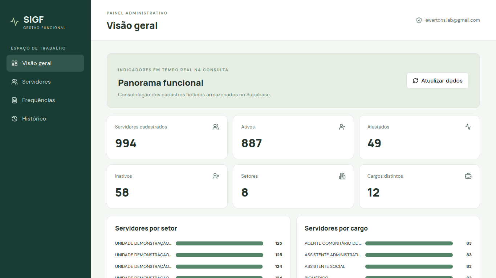
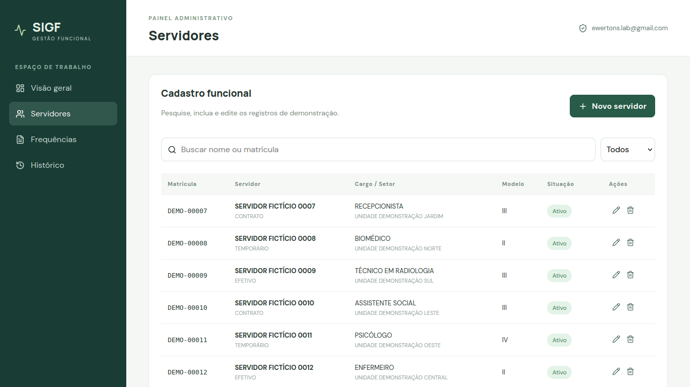
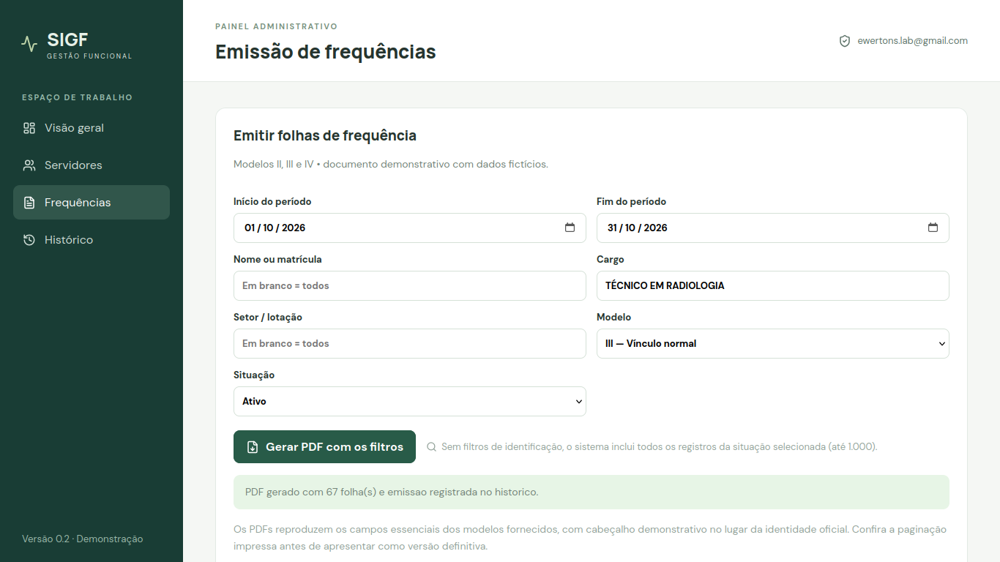
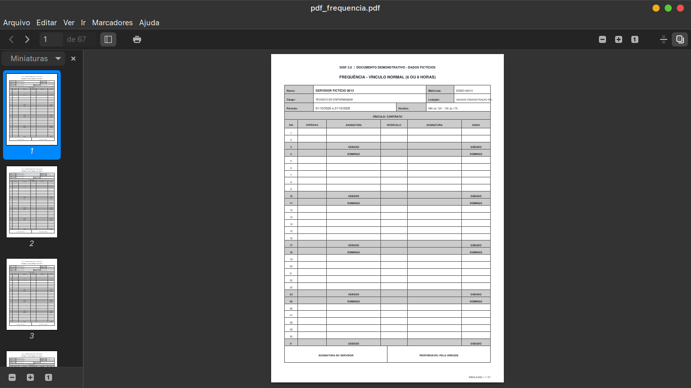
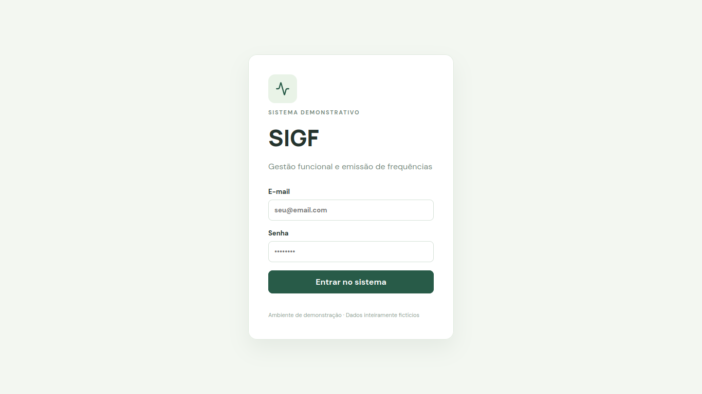

<div align="center">

# SIGF 2.0

### Sistema Integrado de Gestão de Frequências

**Gestão funcional, emissão de documentos e indicadores administrativos em uma aplicação web.**

[**Acessar demonstração**](https://sigf.ewertons-lab.workers.dev) · [**Ver funcionalidades**](#funcionalidades) · [**Conhecer o projeto**](#origem-do-projeto)

</div>

> [!IMPORTANT]
> **Projeto demonstrativo e independente.** Todos os dados de servidores e unidades utilizados na demonstração são fictícios. O SIGF 2.0 não é um sistema oficial, não possui vínculo institucional com a Prefeitura de Belém ou com unidades de saúde e não deve ser utilizado para documentos oficiais.
>
> **Status da hospedagem:** o endereço acima já foi configurado, mas a última verificação mostrou uma tela de configuração do Supabase. O acesso público só estará funcional após concluir a configuração das variáveis de ambiente no build e fazer um novo deploy.

## Origem do projeto

O SIGF 2.0 nasceu da evolução de uma solução desenvolvida anteriormente para atender a uma necessidade administrativa em um ambiente hospitalar.

O fluxo original utilizava **planilhas Excel como base de registros** e **modelos Word com mala direta** para gerar folhas de frequência. Embora resolvesse o problema imediato, exigia etapas manuais para selecionar servidores e produzir documentos.

Nesta versão, reconstruí a ideia como uma aplicação web: os registros são armazenados em um banco de dados online, os usuários acessam o sistema por login e as frequências são geradas diretamente a partir de filtros. O objetivo é demonstrar a modernização de um processo administrativo real, sem reutilizar dados pessoais do ambiente original.

## Funcionalidades

- **Autenticação e perfis:** acesso com Supabase Auth e papéis `admin` e `emissor`.
- **Gestão de servidores:** cadastro, listagem, busca, edição e exclusão de registros, conforme as permissões do usuário.
- **Filtros de emissão:** geração por servidor específico, seleção múltipla, cargo, setor e outros critérios disponíveis na interface.
- **Três modelos de frequência:**
  - **Modelo II:** ECH, hora extra e plantão;
  - **Modelo III:** vínculo normal (jornadas de 6 ou 8 horas);
  - **Modelo IV:** Mais Médicos / Médicos pelo Brasil.
- **Períodos configuráveis:** folhas que abrangem intervalos entre meses, conforme a necessidade do modelo.
- **PDFs individuais ou em lote:** documentos prontos para conferência e impressão.
- **Dashboard:** indicadores de cadastros, situações e distribuições funcionais alimentados pelo Supabase.
- **Auditoria:** registro das operações de cadastro, edição e exclusão.
- **Histórico de emissões:** registro das gerações de arquivos PDF.
- **Base sintética:** aproximadamente **1.000 servidores fictícios** para navegação, filtros e testes.

## Demonstração

**Site:** [sigf.ewertons-lab.workers.dev](https://sigf.ewertons-lab.workers.dev)

| Campo | Acesso demonstrativo |
| --- | --- |
| E-mail | `teste@sigf.com` |
| Senha | `Admin@sigf2` |
| Perfil | `emissor` |

A conta pública pode **consultar os dados necessários à emissão e gerar frequências individuais ou em lote**. Ela **não pode cadastrar, editar ou excluir servidores**, nem administrar perfis ou consultar as áreas restritas ao administrador. Essas permissões são aplicadas no banco, não apenas na interface.

**Observação:** as credenciais acima são intencionalmente públicas e devem ser usadas somente com uma base demonstrativa isolada. Não use a senha em outras contas.

## Capturas de tela

As imagens devem ser salvas em `docs/screenshots/`, com os nomes indicados abaixo.

### Visão geral



### Gestão de servidores



### Emissão de frequências



### Documento PDF



### Acesso ao sistema



## Tecnologias

| Camada | Tecnologia |
| --- | --- |
| Interface | React, TypeScript, Vite e CSS |
| Ícones | Lucide React |
| Autenticação | Supabase Auth |
| Banco de dados | Supabase / PostgreSQL |
| Controle de acesso | Row Level Security (RLS) |
| Documentos | Geração de PDF no frontend |
| Hospedagem | Cloudflare Workers (implantação do frontend) |

## Estrutura do projeto

```text
SIGF/
├── docs/
│   └── screenshots/
│       ├── dashboard.png
│       ├── servidores.png
│       ├── frequencias.png
│       ├── pdf-frequencia.png
│       └── login.png
├── src/
│   ├── components/
│   ├── lib/
│   ├── styles/
│   ├── App.tsx
│   └── main.tsx
├── public/
├── index.html
├── package.json
└── README.md
```

*A árvore resume as pastas relevantes e deve ser ajustada caso a organização do código mude.*

## Executar localmente

**Pré-requisitos:** Node.js e npm compatíveis com as dependências do projeto; projeto Supabase já configurado com o esquema e políticas correspondentes.

```bash
git clone git@github.com:wesomelo97/sigf.git
cd sigf
npm install
```

Crie um arquivo `.env.local` na raiz:

```dotenv
VITE_SUPABASE_URL=https://SEU-PROJETO.supabase.co
VITE_SUPABASE_PUBLISHABLE_KEY=sb_publishable_SUA_CHAVE
```

Depois, execute:

```bash
npm run dev
```

Para validar o build:

```bash
npm run build
```

**Importante:** o repositório público não inclui a configuração completa do banco de dados nem os scripts de criação das políticas RLS. Portanto, clonar o frontend e adicionar as variáveis **não é suficiente para reproduzir uma instalação independente**. O projeto funciona com o Supabase de demonstração já configurado. A configuração do backend poderá ser documentada e disponibilizada separadamente no futuro.

Não publique `.env.local`, chaves secretas, planilhas originais, backups de bancos institucionais ou dados pessoais reais.

## Evoluções previstas

- Refinamento visual e analítico do dashboard;
- Melhorias na experiência de filtros e emissão em lote;
- Documentação reproduzível do esquema e das políticas do banco;
- Revisões adicionais de segurança e operação para cenários além do portfólio.

## Sobre o projeto

Este é um **MVP demonstrativo funcional**, criado para apresentar habilidades de análise de processos, modelagem de dados, desenvolvimento frontend, integração com serviços e geração de documentos. Não se trata de software homologado para uso institucional.

**Desenvolvimento:** [Ewerton Melo](https://github.com/wesomelo97)
